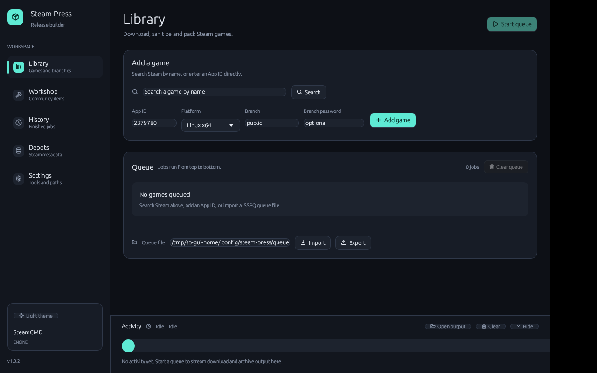
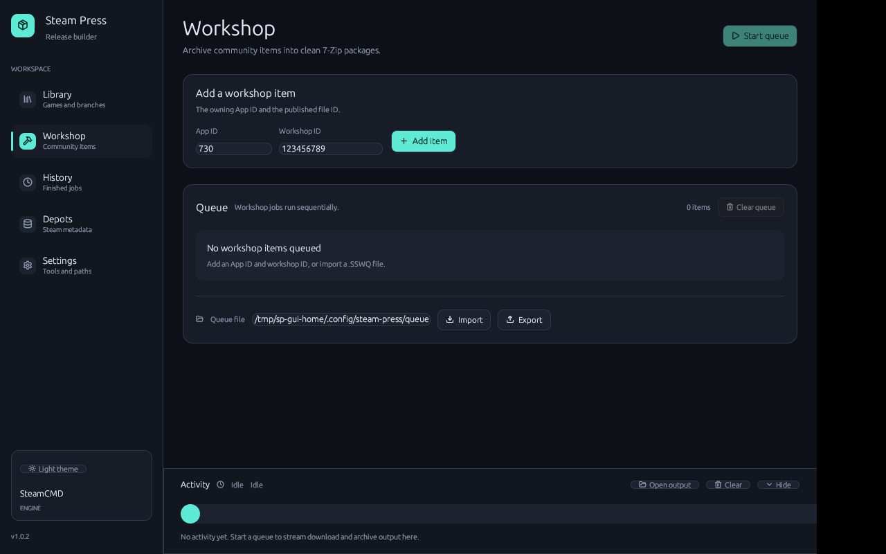
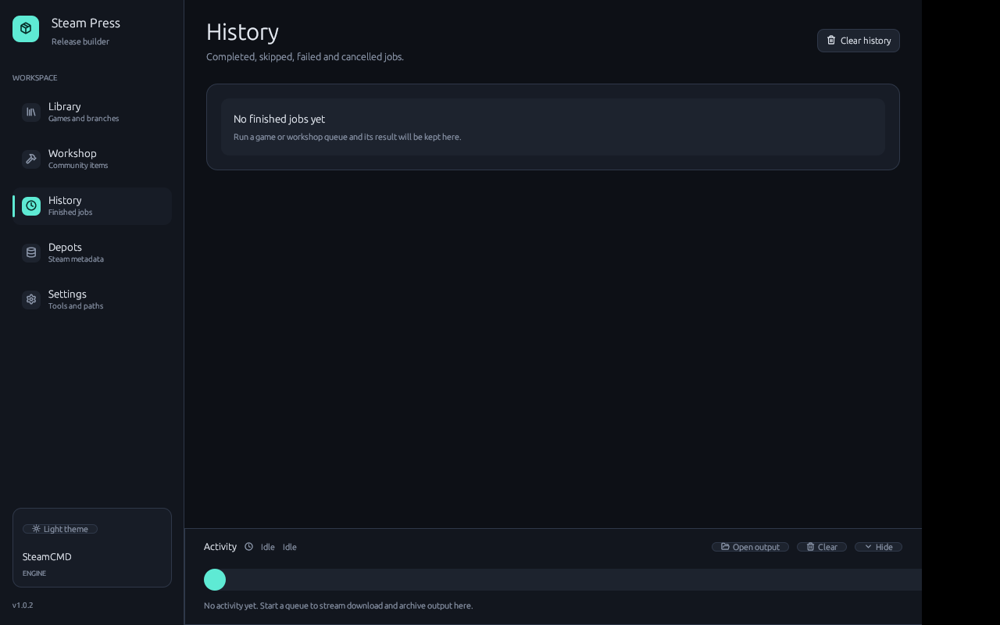
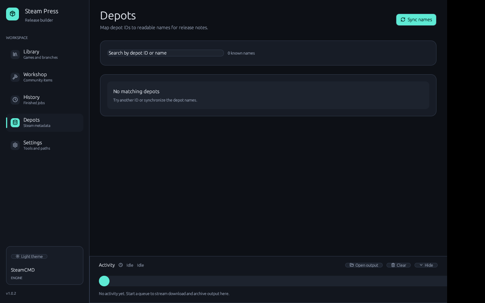
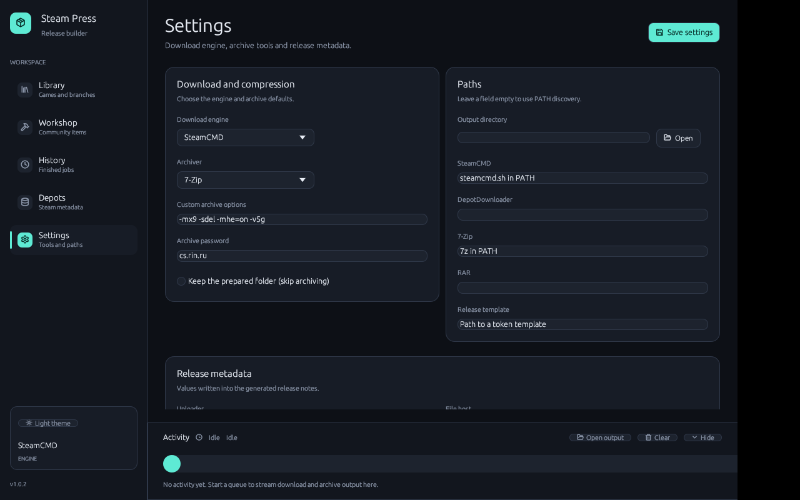
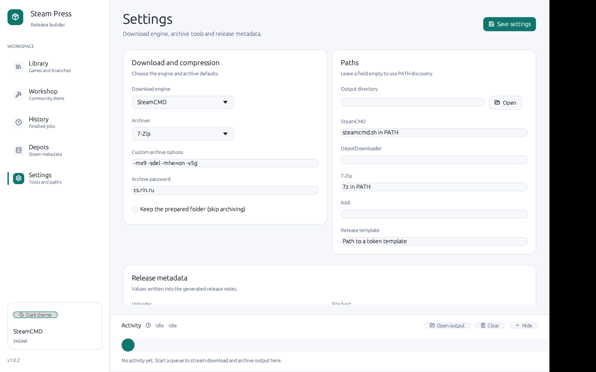

# Steam Press — Guide d'utilisation

## 1. Installation des outils

Steam Press n'embarque ni SteamCMD ni 7-Zip.

```bash
# SteamCMD (Linux)
mkdir -p ~/steamcmd && cd ~/steamcmd
curl -sqL https://steamcdn-a.akamaihd.net/client/installer/steamcmd_linux.tar.gz | tar zxvf -
./steamcmd.sh +quit
# Puis ajoutez ~/steamcmd au PATH, ou renseignez steamcmdpath dans les réglages.

# 7-Zip
sudo apt install p7zip-full      # fournit 7z
```

Pour RAR, fournissez vous-même un binaire `rar` légalement obtenu (RAR est propriétaire).
Pour DepotDownloader, placez le binaire `DepotDownloader` dans le `PATH` ou indiquez
`depotdownloaderpath`.

## 2. Première configuration

```bash
cargo build --release -p steam-press-cli
./target/release/steam-press login          # ou : login --username anonymous
./target/release/steam-press doctor
./target/release/steam-press depots sync
```

`doctor` doit afficher les chemins de SteamCMD et 7-Zip, le nombre de dépôts connus, un
dossier de sortie inscriptible, l'espace libre, l'état du coffre d'identifiants, la
joignabilité de l'API Steam, la présence de SteamCMD et les versions de 7-Zip,
RAR et DepotDownloader (minimums : 21.0, 6.0 et 3.3.0). SteamCMD n'expose pas
de version sémantique stable : seule sa présence est vérifiée. Une version trop
ancienne ou un outil absent est signalé avec l'action corrective correspondante. Les codes de sortie sont documentés dans
[exit-codes.md](exit-codes.md).

## 3. File de jeux

Pour retrouver un AppID à partir du nom du jeu :

```bash
steam-press search "half-life"
steam-press search "half-life" --json
steam-press info 2379780 --json
```

La commande interroge le Steam Store et affiche l'AppID et le nom des résultats. `--json`
produit une sortie exploitable par un script ; l'option est globale et fonctionne aussi avec
`doctor`, `login`, `queue`, `workshop`, `depots`, `pack`, `template`, `import` et `diff`.

```bash
steam-press queue add 2379780 --os lin64 --branch public
steam-press queue add 123456 --os win64 --branch beta --branch-password secret
steam-press queue list
steam-press queue move 2 1
steam-press queue export ./ma-file.sspq
steam-press queue import ./ma-file.sspq
```

Format `.SSPQ`, compatible SuperSteamPacker :

```
lin64|2379780|public|
win64|123456|beta|secret
```

Les lignes vides, commentaires (`;`, `#`) et lignes incomplètes sont tolérés à l'import.

## 4. Téléchargement et compression

```bash
# Préflight sans téléchargement
steam-press pack --appid 2379780 --os lin64 --anonymous --dry-run

# Téléchargement + 7z par défaut
steam-press pack --appid 2379780 --os lin64

# RAR, sortie personnalisée, moteur DepotDownloader
steam-press pack --appid 2379780 --os win64 --compressor rar \
  --downloader depotdownloader --output /mnt/games/Packs

# Sans compression (dossier conservé)
steam-press pack --queue ~/.config/steam-press/queue.sspq --no-compress
```

Nommage de sortie, identique à SuperSteamPacker :

```
<Jeu>.Build.<buildid>.<OS>.<branche>.7z
<Jeu>.Build.<buildid>.<OS>.<branche>.rar
<Jeu>.Build.<buildid>.<OS>.<branche>/   (sans compression)
```

Les options 7-Zip par défaut sont `-mx9 -sdel -p<mot de passe> -mhe=on -v5g`.
Si un seul volume `.7z.001` est produit, il est renommé en `.7z`.

Un job dont l'archive existe déjà est ignoré. `--compressor none` équivaut à
`--no-compress`. Après compression, un manifeste `<Jeu>...sha256` est écrit à côté des
volumes ; il est compatible avec `sha256sum -c`.

Avant le téléchargement, Steam Press vérifie l'espace libre (avec une marge réglable via
`diskmarginmb`) et estime la taille des dépôts. Un dossier de travail interrompu est repris
au prochain lancement ; `--fresh` l'efface pour repartir de zéro. Quand `verifyarchives=1`,
chaque archive est testée avec l'outil de compression après sa création (mot de passe inclus).

Les dépôts partagés (`shareddepots`) sont téléchargés avec le jeu et reçoivent un
`appmanifest_228980.acf` valide dans `steamapps`.

### Steam Guard

Un compte protégé par Steam Guard peut demander un code envoyé par e-mail ou généré par
l'application mobile. Le code est **à usage unique** et n'est jamais enregistré.

```bash
# Code fourni une seule fois pour ce lot.
steam-press pack --steam-guard-code 12345

# Même option pour l'atelier.
steam-press workshop run --queue ./atelier.sswq --steam-guard-code 12345
```

En mode interactif (sans `--json` et avec un terminal), si Steam réclame un code,
Steam Press affiche `Steam Guard code:` et relance le job une fois le code saisi. En
mode `--json`, aucun prompt n'est émis : fournissez `--steam-guard-code`, sinon le job
échoue avec un message explicite.

Avec SteamCMD, le code est placé dans le script temporaire `0600` supprimé après le job.
Si vous approuvez plutôt la connexion dans l'application mobile, SteamCMD peut afficher
`Steam Guard must be approved before continuing` : cette ligne reste dans le journal même
quand la connexion réussit, et Steam Press ne la traite comme un échec que si SteamCMD
sort en erreur ou n'affiche pas son marqueur de succès (un dossier de contenu déjà présent
ne suffit pas). Avec DepotDownloader, le mot de passe et le code sont écrits sur l'entrée
standard du processus, jamais sur la ligne de commande.
Dans la GUI, le champ **Steam Guard code** se trouve dans **Settings > Steam account** ;
après un échec, le bandeau d'erreur propose un champ et un bouton **Retry** pour saisir
un code frais ou relancer après approbation mobile.

## 5. Import local et diff

```bash
# Importer une installation existante sans télécharger.
steam-press import /games/MyGame --appid 2379780 --os lin64 --compressor 7z

# Comparer deux dossiers de build.
steam-press diff ./build-a ./build-b

# Écrire une archive de mise à jour dans le dossier de sortie.
steam-press diff ./build-a ./build-b --archive --stem MyGame.patch

# Sortie JSON pour l'automatisation.
steam-press diff ./build-a ./build-b --json
```

`import` lit les métadonnées Steam, prépare les manifestes et compresse le dossier fourni.
`diff` compare les tailles et les empreintes SHA-256, affiche les fichiers ajoutés, modifiés et
supprimés, puis peut copier les ajouts/modifications dans une archive. Quand des fichiers ont
été supprimés, l'archive contient aussi `deleted_files.txt` ; il faut appliquer cette liste
après extraction pour que l'ancienne build soit réellement remplacée.

## 6. Atelier

```bash
steam-press workshop add 730 123456
steam-press workshop list
steam-press workshop run --queue ~/.config/steam-press/queue.sswq
```

Format `.SSWQ` : `appid|workshopid`. L'import accepte aussi les lignes
`workshop_download_item <appid> <id> validate`. La sortie s'appelle
`Workshop_<appid>_<id>.7z`.

## 7. Manifestes et vie privée

Après téléchargement, Steam Press :

1. déplace `steamapps`/`depotcache` dans un dossier temporaire ;
2. supprime `libraryfolders.vdf`, `downloading/`, `temp/` et les fichiers Workshop
   temporaires ;
3. remet `LastOwner` et `LauncherPath` à `"0"` dans l'`.acf` existant ;
4. génère un `.acf` complet si le moteur n'en a pas fourni ;
5. génère un `appmanifest_228980.acf` pour les dépôts partagés ;
6. calcule les lignes `depot - nom [Manifest id]`.

Un `.acf` généré contient `StateFlags 4`, `LastUpdated "0"`, `LastPlayed "0"`,
`LastOwner "0"`, `InstalledDepots`, `UserConfig` et `MountedConfig`.

## 8. Templates

Créez `mon-template.txt`, puis renseignez son chemin dans les réglages (ou `template` dans
`settings.ini`).

```
[url=][color=white][b]{{game_name}} [{{os}}] [Branch: {{branch}}] (Clean Steam Files)[/b][/color][/url]
[size=85][color=white][b]Version:[/b] [i]{{build_datetime_utc}} [Build {{build_id}}][/i][/color][/size]

[spoiler="Depots & Manifests"][code=text]{{#depots}}{{depot_id}} - {{depot_name}} [Manifest {{manifest_id}}]
{{/depots}}[/code][/spoiler]

Uploaded by {{username}} on {{upload_date}}.
```

Test rapide sans Steam :

```bash
steam-press template render ./job.json ./mon-template.txt
```

`job.json` accepte les champs `game_name`, `os`, `branch`, `build_id`, `build_datetime_utc`,
`app_id`, `description`, `website`, `username`, `filehost`, `upload_date` et `depots`
(tableau de `depot_id`, `depot_name`, `manifest_id`).

## 9. Réglages

Les clés de `settings.ini` restent compatibles avec SuperSteamPacker :

```ini
[SSP]
formatversion=1
compressor=7z
customcompressoption=
skipcompression=0
darkmode=1
uploadcrewmode=0
rinruusername=
filehost=
outputdir=
steamcmdpath=
depotdownloaderpath=
sevenzippath=
rarpath=
compresspassword=cs.rin.ru
template=
key=<clé locale>
verifyarchives=1
diskmarginmb=1024
```

## 10. Mises à jour de la GUI

La GUI vérifie automatiquement les releases principales `v*` au démarrage. La page **Settings
> Updates** affiche la version courante, permet de relancer la vérification et d'installer une
mise à jour. L'archive est téléchargée depuis GitHub, son empreinte SHA-256 est vérifiée, puis
l'exécutable est remplacé et l'application redémarre. L'installation automatique fonctionne
sous Linux et macOS ; sous Windows, l'application indique l'archive à télécharger et à
décompresser manuellement. Elle nécessite un accès en écriture au dossier de l'exécutable.
Les files Library et Workshop ainsi que l'historique sont sauvegardés automatiquement et
restaurés au lancement suivant. L'onglet **History** permet de rouvrir le dossier de sortie
d'un job terminé, de consulter son journal et de le relancer.

## 11. Erreurs fréquentes

| Message | Cause / solution |
|---|---|
| `SteamCMD introuvable` | installez SteamCMD ou renseignez `steamcmdpath` |
| `ce compte ne possède pas ce jeu` | le compte doit posséder l'app (`No subscription`) |
| `Steam limite temporairement les téléchargements` | attendez avant de relancer (`Rate Limit Exceeded`) |
| `identifiants Steam invalides ou Steam Guard requis` | vérifiez le mot de passe, approuvez la connexion dans l'application mobile, ou relancez avec `--steam-guard-code` / saisissez le code affiché par SteamCMD |
| `7-Zip introuvable` | installez `p7zip-full` ou renseignez `sevenzippath` |
| `aucun identifiant enregistré` | `steam-press login` ou `--anonymous` |

## 12. Sécurité

- Les identifiants sont chiffrés en AES-256-GCM avec une clé générée localement.
- Le fichier `credentials.bin` est créé en mode `0600`.
- Les mots de passe ne sont jamais journalisés et ne sont pas passés en argument de
  processus à DepotDownloader.
- Les codes Steam Guard sont à usage unique, jamais enregistrés, et transmis à
  DepotDownloader par l'entrée standard.
- Le script SteamCMD temporaire est lui aussi créé en `0600` puis supprimé.

Le modèle de menace complet et les limites du coffre sont décrits dans
[security-review.md](security-review.md). La sortie `--json` et sa version de schéma sont
décrites dans [json-schema.md](json-schema.md).

## 13. Aperçu de la GUI

La GUI reprend les mêmes réglages et files que le CLI. Les captures ci-dessous ont été
prises avec la version 1.0.2 sous Linux/X11 ; elles servent de référence visuelle, pas de
promesse de rendu identique sur chaque plateforme.

### Library



### Workshop



### History



### Depots



### Settings



### Thème clair



La file et l'historique sont enregistrés dans le dossier de configuration ; ils sont
restaurés au lancement suivant. Le bouton de thème bascule entre clair et sombre
immédiatement ; pour conserver le choix, utilisez **Save settings**.
